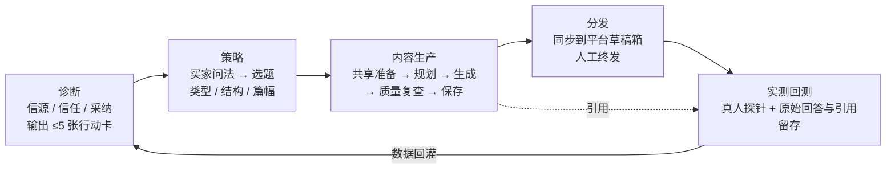

# 源引 GEO：让品牌在 AI 答案里"可被引用"（产品设计档案）

> **项目卡片** · 时间：2026.07–2026.10 · 角色：产品负责人 + 全栈实现 + 评测 · 技术栈：Next.js 14 · Prisma · Supabase · DeepSeek · TipTap · 浏览器扩展 · 状态：已上线免费内测，2026.10 阶段性中止

> 一句话：源引 GEO 是一个"把买家会问 AI 的问题写成可被引用的结构化长文，并同步到国内媒体草稿箱"的 AI 产品。本仓库记录它的产品设计、Agent 架构、指标度量与评测边界，以及一个人从 0 到 1 做这个产品时的关键取舍。

**给读者的话**：这个项目已经停了。比"做过什么功能"更值得看的，是我在哪些地方做了判断、哪些判断后来被我自己推翻、以及我如何区分"做完了"和"验证过了"。仓库里的数字都是内部实验或验收记录，会注明样本量；没有验证过的，我会写"没有验证"。

- 作品集单页：[https://zhaolijian.github.io/cases/geo.html](https://zhaolijian.github.io/cases/geo.html)

---

## 1. 项目背景

### 1.1 问题：用户的决策入口从搜索迁移到了 AI 问答

当潜在客户开始问豆包、DeepSeek、通义千问"某类需求下有什么品牌/服务商推荐"时，品牌在生成式答案里的可见性，取决于两件事：**AI 有没有读到你的信息（信源）**，以及**它敢不敢、愿不愿意用你的信息回答（信任与采纳）**。

对中小企业来说，这件事的难点很具体：

- 他们知道要"做 AI 优化"，但不知道从哪下手——市面上要么卖曝光，要么卖"AI 写稿"，很少有人回答"我为什么没被提到、该改什么、改完有没有用"；
- 他们通常没有专职内容团队，写长文、做分发、做效果验证，每一步都是断的；
- 他们已有的品牌资料散落在官网、公众号、工商信息里，AI 能不能正确归并到"同一个主体"，没人检查过。

### 1.2 我的解法：不是"万能写稿机"，而是一条可验证的 GEO 闭环

我把产品拆成四段，并明确每一段"交付什么、怎么算有效"：

1. **诊断**：品牌为什么没被 AI 提到——信源 / 信任 / 采纳三层归因，输出 ≤5 张优先行动卡；
2. **策略**：该写什么——从买家问法出发，确定选题、内容类型、结构样式与证据要求；
3. **内容**：可被摘录的成稿——受控 Agent 流水线（预检 → 生成 → 质量复查）产出结构化长文，人工编辑后同步到平台草稿箱；
4. **实测**：改完有没有用——用真人探针在多个 AI 平台按三类问法回测，留存原始回答与引用证据，回灌下一轮诊断。

### 1.3 目标用户（ICP）与"不应该主推的人"

**优先服务**：

- 有明确业务/品类的 **中小 B2B 或服务型品牌**的市场、内容负责人；
- 已有公众号 / 知乎 / 垂直媒体账号，愿意每周至少发 1 篇长文的人；
- **代运营 / 内容工作室**——服务多个品牌客户，对"可复用工作流"敏感；
- 已听说过 GEO / AI 搜索可见性，愿意花 30–60 分钟走完整闭环的人。

**不主推**：

- 只想"一键爆款 / 日更短视频带货"的个人创作者（产品形态与动机错位）；
- 期望 SaaS 自动终发、养号、云端托管平台账号的人（明确不做，见 [docs/07](./docs/07-publish-boundary.md)）；
- 无品牌素材、无平台账号、只想逛一逛的纯好奇用户（反馈噪声大，会污染早期判断）。

---

## 2. 我的角色

我是这个项目的**独立开发者**，产品、工程与评测都由我一个人完成：

- **产品**：需求定义、ICP、模块拆分、PRD、原型与交互、指标口径、验收标准；
- **工程**：Next.js 全栈、数据模型与迁移、检索与生成链路、后台任务与时预算、浏览器扩展同步链路、评测脚本；
- **评测与运营**：真人探针实测、文章质量验收、内测邀请与反馈记录；
- **没有团队**：产品判断、实现、验证都在一个人手里，所以这份档案里的每个取舍，我都能说清当时的约束和代价。

我更愿意把它定义成"**一个人的 0→1 产品**"，而不是"一个团队的项目"：它能说明我怎么在资源有限时做减法、怎么定义"做完"，以及什么时候承认"这条路暂时走不通"。

---

## 3. 关键决策（每条：背景 → 取舍 → 结论 → 代价）

完整论证在 `docs/02`–`docs/07`，这里只放结论和代价。

### 决策一：只同步到平台草稿箱，不做自动发布、不做养号

- **背景**：如果产品能"一键发布到全平台"，演示效果最好，也最容易卖；但自动终发踩平台 ToS 灰区，账号被封的成本由用户承担。
- **取舍**：自动化程度 vs 账号安全与合规。我选择把发布权留给用户，产品只负责把内容送到"离发布只差一步"的位置。
- **结论**：MVP 的"发布"= 同步到平台后台草稿箱 + 展示结果与深链；登录态与 Cookie 不上云，执行在用户侧浏览器扩展里完成。
- **代价**：用户仍要手工点"发布"，体验不闭环；同步成功率受扩展、平台改版影响；我也必须长期维护与第三方同步执行器的适配。详见 [docs/07](./docs/07-publish-boundary.md)。

### 决策二：诊断不做 0–100 黑盒总分，也不把提及率搬上诊断页

- **背景**：行业常见做法是给一个"AI 可见度分数"，用户看得懂、销售也好讲；但分数解释不了原因，用户不知道下一步做什么。
- **取舍**："好卖的总分" vs "可归因、可行动"。
- **结论**：诊断只输出三层客观结论 + 最多 5 张优先行动卡；不把实测的提及率换名再报一遍；"没测到"一律标未评估，不制造虚假通过。详见 [docs/04](./docs/04-brand-diagnosis-model.md)。
- **代价**：没有单一指标可炫耀，汇报不直观；必须先有合格的实测数据才能做归因，冷启动体验更重。

### 决策三：预检从"生成前补资料"改为"共享准备 + 正文后一次有界补查"

- **背景**：最初的设计是"生成前先做一次预检，把素材缺口补上再写"。做出来后我发现两个问题：预检和生成各自准备资料，口径不一致；用户也可能绕过预检直接生成。
- **取舍**：把准备工作做在生成前（体验顺，但成本前置、容易白做）vs 只做一次共享准备、正文产出后按疑点做一次有界补查（更省、更准，但问题暴露得晚）。
- **结论**：把"资料准备 + 条件检查"合并成一次共享准备，两个入口复用同一份结果；素材骨架那套系统被删掉，预检只输出可采纳的条件建议与必要的私有资料提醒。详见 [docs/03](./docs/03-topic-preflight-v1.md)。
- **代价**：预检的"厚重感"下降，用户少了一个看起来很强的功能；补查只能做一次，漏检风险由验收流程承担。

### 决策四：探测走本地浏览器 + 真人登录态，不云端托管平台账号

- **背景**：要测"AI 答案里有没有你"，最稳的方式是像真人一样在网页端提问；而云端托管用户平台账号是明确的合规与安全红线。
- **取舍**：采集效率 vs 合规与账号安全。
- **结论**：探针跑在本地真人浏览器里，登录态只留在本机且不提交；平台侧只做"公开可见"的网页采集，不做绕过与自动化风控。
- **代价**：采集慢、依赖本机环境、无法规模化；跨用户并发也做不起来。详见 [docs/05](./docs/05-measure-audit.md)。

### 决策五：先定义"什么算好文章"，再谈自动化

- **背景**：AI 生成的文章"看起来都还行"，如果验收只看"有没有公司名、字数够不够"，产品会稳定地交付平庸内容。
- **取舍**：先做验收标准（慢，且会暴露很多问题）vs 先堆生成能力（快，但无法判断是否在变好）。
- **结论**：先冻结六个内容维度与四类独立判定，再冻结 8 类任务集、写明通过门槛，最后才让 Agent 跑真实任务；验收证据必须能回溯到原句。详见 [docs/06](./docs/06-eval-and-boundaries.md)。
- **代价**：验收成本高，真实模型调用要按批次冻结、不能挑最好的一次；很多"体感不错"的稿子在标准下判不过。

---

## 4. 技术架构

### 4.1 一张图：诊断 → 策略 → 内容 → 分发 → 实测回测

### 4.2 分层与"为什么这样分层"

| 层 | 做什么 | 为什么单独一层 |
|---|---|---|
| Web 应用（Next.js 全栈） | 账号、品牌资料、创作与编辑工作台、诊断与实测界面 | 一个人维护，全栈同源比前后端分离省维护成本；编辑体验用 TipTap，贴近"可发布的成稿" |
| 后台任务层 | 预检、生成、质量复查、配图、探测任务 | 长任务不能挂在同步请求上；用任务 + 轮询 + 超时/取消/重试把用户等待变成可解释的状态 |
| 内容生成链路 | 共享准备 → 规划 → 生成 → 质量复查（单次编辑式）→ 保存 | 把"一次性大 Prompt"拆成有预算、有硬约束、可回退的多步流程，避免整篇重写带来的事实漂移 |
| 数据层 | Prisma + Supabase PostgreSQL；知识库切片与混合检索 | 关系数据与向量共库，检索一条 SQL 内完成关键词 + 向量融合，省一个向量库的运维 |
| 用户侧执行器 | 浏览器扩展：登录态在本地，把正文送到平台草稿箱并回传结果 | 云端不接触平台凭证；平台适配属于"用户侧动作"，失败可解释、可降级为复制粘贴 |

### 4.3 架构相关截图与流程图

- 内容生产两条流水线的完整流程/交互图：[assets/diagrams/article-agent-flow.svg](./assets/diagrams/article-agent-flow.svg)（矢量版，任务上限与交互边界都在图上；[光栅版](./assets/diagrams/article-agent-flow.webp)）。这是文章 Agent **最后一版**（未部署）的工程流程图。
- 文章工作台界面（已脱敏，演示数据）：[assets/screenshots/geo-workspace.webp](./assets/screenshots/geo-workspace.webp)

> 图中的秒数与调用次数是**任务预算/上限**，不是实测平均耗时。

---

## 5. 结果与边界

### 5.1 做到了什么

- **已上线免费内测**（yuanyingeo.com，需邮箱注册）；跑通了「注册 → 品牌资料 → 选题/预检 → 生成 → 编辑 → 同步草稿箱 → 真人探针实测 → 诊断回看」主路径；
- 核心模块可用：账号与数据隔离、品牌资料、选题入口与预检、文章生成与编辑、多平台草稿箱同步、品牌实测、品牌诊断；
- 沉淀了可复用的资产：GEO 三层诊断模型、内容生产 Agent 的流水线与预算设计、文章质量验收标准与冻结任务集、品牌实测的指标口径与自审方法。

### 5.2 没做到什么（边界，必须写清）

- **阶段**：2026.10 做小范围推广、邀请朋友试用后，效果与商业化未达预期，**项目已阶段性中止**；此后没有再对外运营，只保留了一轮未部署的产品与评测迭代（`docs/02`、`docs/06` 记录的就是这一版），用于复盘和作品集整理；
- **增长**：没有规模用户，没有留存/付费数据；谈不上增长验证；
- **效果**：**没有验证**"用了这个产品，品牌在 AI 答案里的引用/推荐一定变好"——GEO 本身有随机性，我给出的只是可回测的方法，不是效果承诺；
- **商业化**：无营收；内测期免费开放，**没有验证过任何定价**；
- **工程**：后台任务状态在单进程内，重启会丢进行中任务（验证阶段记录、未修复）；同步依赖浏览器扩展与平台现状；内容质量依赖素材与模型，无法保证达标；
- **评测**：文章 Agent 的严格业务质量与全部 P0 验收**尚未通过**（详见 [docs/06](./docs/06-eval-and-boundaries.md)）；诊断与实测的样本都很小，不能当行业基准。

### 5.3 我为什么把它停掉

- **需求侧**：目标用户愿意"试试"，但不愿意为"可被引用"这种间接结果持续投入；真实预算仍然流向能直接带来询盘的动作。
- **效果侧**：我无法在可接受的成本内，向一个小客户证明"这篇文章让 AI 更愿意引用你"——链路的因果太长、样本太小。
- **商业侧**：没有验证过的定价，也没有可复用的获客渠道，继续投入只会把"一个人做产品"变成"一个人做运营"。
- **我的判断**：它的方法论价值（诊断归因、受控 Agent、评测标准）大于它的商业价值，所以选择阶段性中止，把沉淀写清楚。

---

## 6. 目录说明与阅读顺序

### 6.1 文档

| 文件 | 一句话 |
|---|---|
| [docs/01-product-overview.md](./docs/01-product-overview.md) | 产品概览：问题、ICP、模块地图、刻意不做清单 |
| [docs/02-article-agent-prd.md](./docs/02-article-agent-prd.md) | 内容生产 Agent：两条流水线、状态机、预算、门禁、人工在环 |
| [docs/03-topic-preflight-v1.md](./docs/03-topic-preflight-v1.md) | 选题预检 v1：方案与它后来为什么被推翻 |
| [docs/04-brand-diagnosis-model.md](./docs/04-brand-diagnosis-model.md) | 诊断模型：三层归因与三条"诊断合法性条件" |
| [docs/05-measure-audit.md](./docs/05-measure-audit.md) | 品牌实测的审视性自审：分级问题、指标口径、小样本 n、局限 |
| [docs/06-eval-and-boundaries.md](./docs/06-eval-and-boundaries.md) | 怎么定义"好文章"、怎么证明、当前局限（含 30 篇复测数据） |
| [docs/07-publish-boundary.md](./docs/07-publish-boundary.md) | 为什么只同步到草稿箱：不代发布、不养号的取舍 |

### 6.2 资源

| 路径 | 说明 |
|---|---|
| [assets/diagrams/article-agent-flow.svg](./assets/diagrams/article-agent-flow.svg) | 内容生产两条流水线与交互边界的完整流程图（矢量） |
| [assets/diagrams/article-agent-flow.webp](./assets/diagrams/article-agent-flow.webp) | 同一流程图的光栅版（由矢量源渲染，便于预览） |
| [assets/screenshots/geo-workspace.webp](./assets/screenshots/geo-workspace.webp) | 文章工作台界面（演示数据，已脱敏） |

### 6.3 建议阅读顺序

1. 只想看结论：本 README 的 §3、§5；
2. 想看产品判断：`docs/01` → `docs/04` → `docs/03`；
3. 想看 Agent 设计与评测：`docs/02` → `docs/06` → `docs/05`；
4. 想看边界与合规取舍：`docs/07`。

### 6.4 相关链接

- 作品集单页（本项目）：[https://zhaolijian.github.io/cases/geo.html](https://zhaolijian.github.io/cases/geo.html)
- 内测期产品站：yuanyingeo.com（项目已阶段性中止，链接仅作事实记录）

---

## 7. 版权与许可

- 本仓库文档为作者原创，采用 [CC BY 4.0](https://creativecommons.org/licenses/by/4.0/deed.zh) 许可；引用请注明出处。
- 仓库不含生产代码、Prompt 全文、部署配置、客户信息与第三方材料；产品截图使用演示/脱敏数据。
- 文中涉及的平台名称仅用于说明分发形态，相关商标归各自权利人。

---

## 相关仓库与链接

- [chinese-rose-showcase](https://github.com/zhaolijian/chinese-rose-showcase)：阅记：纸质书笔记助手的产品、架构与止损复盘
- [ai-lab](https://github.com/zhaolijian/ai-lab)：AI 应用方法论集：GEO 指标、Agent 评测、OCR 流水线、AI 工作流
- [yanpei-showcase](https://github.com/zhaolijian/yanpei-showcase)：颜配：AI 肤质检测 App 的工程复盘
- [ProductThinking](https://github.com/zhaolijian/ProductThinking)：产品思考文章与读书笔记
- 作品集站点：<https://zhaolijian.github.io>
- GitHub 主页：<https://github.com/zhaolijian>
