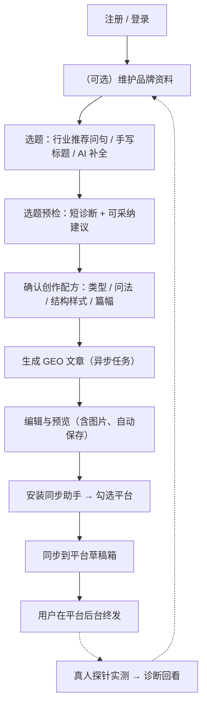

# 源引 GEO 产品概览：问题、用户、模块与刻意不做的事

> 项目卡片 · 2026.07–2026.10（已阶段性中止）· 角色：产品负责人 + 全栈实现 + 评测 · 状态：已上线免费内测，2026.10 小范围推广后阶段性中止

这篇是整套文档的"产品底稿"：回答这个产品是什么、给谁用、由哪些模块组成、以及**我主动不做什么**。后面的 [02](./02-article-agent-prd.md)–[07](./07-publish-boundary.md) 都是这里的某一块的展开。

---

## 1. 一句话与第一性原理

| 层级 | 表述 |
|---|---|
| **问题** | 用户越来越多用 AI 问答做决策；品牌若没有"可被摘录、可被引用"的结构化内容供给，在生成式答案里几乎不可见 |
| **解法** | 不做"万能 AI 写稿机"，而是按 **GEO（Generative Engine Optimization）** 目标组织整条链：诊断 → 选题 → 可引用结构成稿 → 落到媒体草稿箱 → 实测回测 |
| **一句话** | 源引 GEO 帮品牌把"买家会问 AI 的问题"写成可被引用的结构化长文，并同步到国内媒体草稿箱 |
| **成功标准** | 不是"生成了多少篇文章"，而是"品牌是否在可回测的 AI 回答里变得更可见、更可被引用" |

**它不是**：爆款短文案生成器、SEO 关键词堆砌工具、矩阵养号 / 自动上线平台、小红书/抖音图文流水线。

第一性原理写在这里，是因为后面很多取舍都从它推出来：如果产品的目标是"提高被生成式引擎采信与引用的概率"，那么——

- 内容必须**结构化、可摘录**，而不是读起来热闹；
- 效果必须**可回测**，而不是交付一篇稿子就结束；
- 诊断必须**可归因到用户能改的东西**，否则用户听完只会更焦虑。

---

## 2. 目标用户：谁该用，谁不该被主推

### 2.1 优先服务（内测邀请优先）

- 有明确业务/品类的 **中小 B2B 或服务型品牌**的市场、内容负责人；
- 已有公众号 / 知乎 / 垂直媒体账号，**愿意每周至少发 1 篇长文**的人；
- **代运营 / 内容工作室**：同时服务多个品牌，对"可复用工作流"敏感，也更容易看出流程里的断点；
- 已听说过 GEO / AI 搜索可见性，愿意花 30–60 分钟走完整闭环的人。

### 2.2 不应主推（写进试用说明，避免期望债）

- 只想"一键爆款 / 日更短视频带货"的个人创作者：产品形态与动机错位；
- 期望 SaaS **自动终发、养号、云端托管平台账号**的人：这是我明确不做的红线，不是暂时做不了；
- 无品牌素材、无平台账号、只想逛一逛的纯好奇用户：反馈噪声大，会污染早期判断。

这个"反向 ICP"是我刻意训练的：一个 0→1 产品最贵的成本不是开发，是被错误的用户带偏。

---

## 3. 用户主路径与模块地图

### 3.1 主路径

### 3.2 模块地图

| 模块 | 用户得到什么 | 我划定的边界 |
|---|---|---|
| **账号** | 邮箱注册 / 登录 / 退出；找回密码 | 无第三方登录、无手机号、无组织/团队、无套餐计费 |
| **品牌资料** | 每个用户一套品牌信息，生成时按用户品牌注入 | 单品牌；无多品牌工作区 |
| **选题入口** | 行业推荐问句库 + 买家问法筛选；可手写；可 AI 补全/换一批 | 推荐标题是种子目录，不是实时爬榜 |
| **选题预检** | 对标题做短诊断 + 给出可采纳的条件建议与素材方向 | 结果不落库、不强制采纳、不阻止用户直接生成（详见 [03](./03-topic-preflight-v1.md)） |
| **创作配方** | 内容类型：通用问题 / 品牌意图；问法（常见问题、指南、对比、榜单等）；5 种结构样式；篇幅三档 | 成稿后配方只读；要改类型/样式需另开一篇；同步成功后禁止改条件重生 |
| **文章生成** | 生成面向 AI 摘录的结构化 Markdown；异步任务，避免长请求卡死 | 质量依赖素材与模型，**不承诺上榜**；有调用预算与超时（详见 [02](./02-article-agent-prd.md)） |
| **编辑与媒体** | 编辑器自动保存、正文插图上传 | 无协作编辑；封面能力已下线 |
| **文章管理** | 列表 / 打开编辑 / 本人数据隔离 | 站内状态只表示"本地待发布"，平台真实状态以各平台为准 |
| **多平台同步** | 浏览器扩展把正文同步到**平台草稿箱**；展示成功/失败/待确认与深链 | 不等于一键上线；需本机装扩展；短态平台（小红书/抖音）非主路径（详见 [07](./07-publish-boundary.md)） |
| **品牌实测** | 真人探针在多个 AI 平台上按三类问法提问，留存原始回答与引用 | 小样本、只给趋势与 n，不承诺精确百分点；不云端托管平台账号（详见 [05](./05-measure-audit.md)） |
| **品牌诊断** | 三层归因 + ≤5 张优先行动卡 | 不做 0–100 总分、不把提及率换名再报、不制造"没测=通过"（详见 [04](./04-brand-diagnosis-model.md)） |

**结构样式（对外名）**：问题-答案型、清单型、误区纠偏型、案例故事型、数据报告型。

**同步侧常见平台（能力因扩展适配而异）**：知乎、公众号、掘金、CSDN、B站专栏、简书、头条号、百家号、网易号、搜狐号等；终发与审核永远在平台侧。

---

## 4. 刻意不做清单（对外承诺红线）

这些不是"能力没做完"，是主动选择；写进试用说明，避免把预期债留给用户。

| 不做 | 理由 |
|---|---|
| **不承诺进入某大模型"必被引用 / 必上推荐"** | 生成式答案有随机性；承诺结果等于承诺我控制不了的东西，最后会反噬信任 |
| **不默认直接发布上线、不定时群发、不养号** | 平台 ToS 与账号安全；发布权必须留给用户（详见 [07](./07-publish-boundary.md)） |
| **不托管用户各平台 Cookie / 账号密码到云端** | 安全红线；云端一旦持有用户平台凭证，风险与责任都无法兜底 |
| **不做小红书 / 抖音原生图文流水线** | 内容形态错位：长文 Markdown 到短态平台需要另一种改写，硬塞只会两头不讨好 |
| **不把"生成篇数 / 阅读数"当主 KPI** | 它们和"被 AI 引用"不是同一个因果链；用错指标会让产品自己骗自己 |
| **不做 0–100 黑盒总分** | 分数解释不了原因，用户无法行动（详见 [04](./04-brand-diagnosis-model.md)） |
| **不做自动扩写/整篇重写式"优化"** | 整篇重写容易引入无依据事实、破坏已对齐格式；宁可局部可定位地改 |

---

## 5. 内测期该衡量什么（先于"曝光量"）

内测阶段我刻意不看"流量"，而看用户有没有摸到闭环：

| 指标 | 为什么重要 |
|---|---|
| 注册 → 首次成功生成 | 核心激活；生成不出来，后面都不用谈 |
| 生成后 7 日内再次打开 / 再生成 | 是否值得留下 |
| 完成至少 1 次平台草稿同步 | 是否摸到"分发"价值 |
| 结构化反馈条数（问卷 / 访谈） | 本阶段主目标，不是 GMV |
| "若收费，你愿为哪一环付钱" | 为日后定价收集假设（不是定价验证） |

**弱指标（不要当主 KPI）**：纯注册数、自媒体点赞转发、未走完闭环的"试用"。

> 事实是：这组指标我设计了，但内测规模太小（只有小范围推广与朋友试用），**没有收集到足以称为"数据"的样本**。这是项目中止的直接原因之一，也是我在 [06](./06-eval-and-boundaries.md) 里反复强调"样本量"的原因。

---

## 6. 结果与边界

**做到了**：

- 产品上线并可免费注册使用（内测），主路径端到端跑通；
- 从"写稿工具"扩展成"诊断 → 内容 → 分发 → 实测"的闭环，模块之间共享同一套品牌资料与素材；
- 沉淀了两类可复用的东西：**产品方法**（诊断归因、Agent 预算与门禁、验收标准）与**工程实现**（全栈、检索、任务调度、探针与同步）。

**没做到**：

- 没有验证 GEO 效果提升（因果链太长、样本太小，见 [06](./06-eval-and-boundaries.md)）；
- 没有规模用户、没有留存数据、没有营收；
- 内容生产的严格业务质量验收**未全部通过**，同步依赖浏览器扩展，后台任务是单进程实现。

**2026.10 之后**：做了一轮小范围推广与朋友试用，效果与商业化未达预期，项目阶段性中止。我把这次中止当作一次产品判断：**方法论价值 > 商业价值**时，继续投入是在为沉没成本付费，而不是为用户付费。

---

## 7. 如果重来，我会先改什么

1. **更早做最小可用回测**：先用一个客户、一个平台、一个问法集验证"诊断结论能不能指导内容、内容能不能带来可见性变化"，再补工作台与多平台。现在回看，我把最多时间花在了体验层。
2. **更早砍掉非核心场景**：多平台同步、五种结构样式、多篇幅档位，在早期都是复杂度来源；应该先收敛到一个平台、一种结构，把质量打透。
3. **把边界写进产品第一屏**：GEO 的预期管理比功能更重要；"只到草稿箱、不保证上榜"说清楚，反而更容易拿到真实反馈。

---

## 附：相关文档

- [02 内容生产 Agent](./02-article-agent-prd.md)：两条流水线、预算、状态机、门禁
- [03 选题预检 v1](./03-topic-preflight-v1.md)：一个后来被我自己推翻的方案
- [04 诊断模型](./04-brand-diagnosis-model.md)：三层归因与三条合法性条件
- [05 品牌实测自审](./05-measure-audit.md)：指标口径、小样本 n、P1 问题模式
- [06 评测与边界](./06-eval-and-boundaries.md)：怎么定义好文章、怎么证明
- [07 分发边界](./07-publish-boundary.md)：为什么只同步草稿箱
- 作品集单页：<https://zhaolijian.github.io/cases/geo.html>
