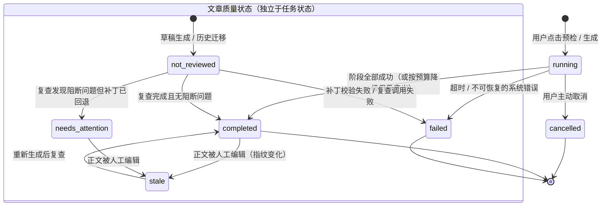

# 内容生产 Agent：两条流水线、状态机、预算与门禁

> 项目卡片 · 2026.07–2026.10（项目收尾阶段版本）· 角色：产品定义 + 全栈实现 + 验收 · 状态：实现完成但未部署（线上免费内测为更早迭代）；严格业务质量与全部 P0 验收**未通过**

这篇文章讲的是我最想被追问的部分：**把"AI 写文章"做成一个可交付的产品，难点不在模型，在于把生成过程变成有预算、有状态、有责任分界、可回退的工作流。**

> 说明：本文的秒数与调用次数来自产品规格里的任务预算/上限，不是实测平均耗时。

---

## 1. 问题：为什么"接一个大模型写文章"不是产品

第一版我犯过一个典型错误：把"生成文章"当成一个 Prompt 问题——标题 + 品牌资料 + 结构要求，一次调用出稿。做出来的结果是：

- **时延不可控**：一次生成 100 秒起步，用户不知道系统在干什么，也不知道会不会失败；
- **质量问题无法定位**：稿子"看起来还行"，但事实错误、主体混淆、篇幅失控混在一起，改一个 Prompt 就换一种坏法；
- **责任边界模糊**：模型编了一个不存在的资质，产品该判它"生成质量问题"还是"用户没提供材料"？没有定义，就没法验收；
- **成本不透明**：一次生成里调了几次模型、哪些调用可以被省掉，完全不可观测。

所以第二版我把它重新定义成：**一条受控流水线**——用户确认写作条件后，系统用固定阶段、固定预算、固定产出契约完成交付，每一步都可观测、可取消、可回退。

**目标不是增加 Agent 名称、运行卡片或核对数量**，而是让用户拿到一篇回答问题、关键事实有依据、可以继续编辑的草稿。

### 目标与非目标

**目标**：

- 用户在生成前知道"条件够不够"，生成后拿到一篇能编辑、能同步的草稿；
- 每个阶段有明确的时间上限、模型调用上限与失败处理；
- 系统能区分"用户输入问题 / 写作建议 / 真实缺证 / 系统异常"，不把自己的错误变成用户的任务；
- 关键事实与业务判断相关的问题不放过，普通表达问题不打扰用户。

**非目标**：

- 不做多 Agent 自主研究、不做全文重写式"优化"、不做视觉理解、不做任意网站爬取；
- 不做自动外部发布（详见 [07](./07-publish-boundary.md)）；
- 不追求"每句话都有引用"——普通解释与建议不要求逐句实证；
- 不承诺生成质量：模型仍可能遗漏、仍可能写得平庸，这些要靠验收暴露，而不是靠更复杂的循环掩盖。

---

## 2. 责任分界表：先把"是谁的问题"分清楚

这是整套设计里我认为最值钱的一页。AI 产品最常见的体验事故，是把**系统异常**说成**用户缺资料**，或者反过来。

| 分类 | 典型例子 | 系统行为 | 用户要做什么 |
|---|---|---|---|
| **输入校验** | 标题为空、标题超长、补充信息超限 | 提交前字段旁提示并定位；后端独立复验；**不启动付费任务** | 改输入；不要看到接口字段名 |
| **写作条件建议** | 标题分面太多但选了简版；结构与表达目的不匹配 | 给具体影响与可采纳建议；**不擅自改标题/类型/篇幅** | 可选采纳，也可坚持自己的选择 |
| **必需品牌信息缺失** | 品牌题但品牌名没维护 | 指出缺哪项并提供品牌资料入口；**不生成虚构主体** | 补品牌名 |
| **真实关键缺证 / 冲突** | 必须给准确套餐价但没有报价；同条件的两份材料口径冲突 | 先在素材预算内查找；仍无法解决时保稿，明确具体所需依据 | 只处理真实存在的缺口 |
| **系统 / 服务异常** | 模型返回格式无效、引用定位失败、存储失败 | 按异常策略恢复、保稿、提示重试；保留诊断码 | **不需要**补业务证明 |
| **后台账号隔离** | 请求其他账号的材料 / 文章 / 任务 | 服务端拒绝，返回不泄露资源存在性的错误 | 没有权限配置功能 |

补充一条我后来才想清楚的原则：**无效参数不一定都是 Bug**。空标题是可修正输入；前端合法操作发出不兼容参数是系统缺陷；会话过期是登录状态；资料在操作中被删除是资源变化——这四种不能统一显示成"参数错误，请检查"。

---

## 3. 两条流水线

用户感知到的只有"预检"和"生成"两个按钮，后台是两条独立的异步任务流水线，通过**共享准备**衔接。

### 3.1 预检流水线（墙钟 240 秒，模型预算 2 次）

| 显示阶段 | 后台在做什么 | 时限 / 重试 | 失败或降级 |
|---|---|---|---|
| 检查输入 | 参数、结构样式、品牌资料校验；读取当前账号的资料目录 | 目录读取 15 秒 | 参数/样式错误直接返回；目录读取失败 → 预检失败提示 |
| 准备资料 | 关键词 + 向量两路召回，融合排序，最多 60 片候选 | 45 秒 | 超时 → 提示"资料查询超时，请重试" |
| 检查写作条件 | 一次模型调用：从候选里选片 + 检查条件是否匹配 + 生成建议 | 客户端 45 秒；格式无效同一次预检内最多 2 次 | 两次仍无效 → 报"预检返回内容异常"；服务错误不隐式重试 |
| 校验与写快照 | 校验资料在任务期间没有变化；写 30 分钟准备快照（按用户隔离） | 15 秒 | 资料变化 → 提示重试 |

交互上的几个决定：

- 前端每 5 秒轮询任务，轮询上限 250 秒（240 + 10 秒最终读取）；
- 相同输入指纹重复点击**复用同一个任务**，已有其他任务时返回冲突提示，不并行烧调用；
- 预检结果只包含**条件建议 + 必要的私有资料提醒 + 简短摘要**，长摘要不上屏；
- 预检**不写正文**、不插最终图片、不新建文章；它只做"条件够不够"的判断。

### 3.2 生成流水线（墙钟 390 秒，模型预算 8 次）

| 显示阶段 | 后台在做什么 | 时限 / 重试 | 失败或降级 |
|---|---|---|---|
| 准备写作资料 | 复用预检快照，或重新准备；注入品牌资料与用户补充信息 | 材料执行上限 240 秒（检索 45 秒） | 失败 → 任务失败，返回可读错误 |
| 规划文章 | 标题解析 → 对象类型 → 读者视角 → 区块形式（段落/列表/步骤/表格）→ 候选与比较维度 | 客户端 45 秒；**失败受控重试 1 次** | 两次失败 → 无规划，按默认格式规则写作 |
| 生成正文 | 生成模型写正文；写作建议是软引导 | 客户端 120 秒；最多 2 次（首版 + 硬约束不符时重写 1 次） | 重写仍不符 → 保留首版并记录问题 |
| 优化文章 | 质量复查一次；补丁 ≤4 处、累计 ≤30%；条件式补查 + 修复复查 | 复查客户端 60 秒；质量阶段调用上限 4 次 | 补丁校验失败 → 整批回退，保留原稿，质量状态 failed |
| 选择配图 | 图库检索 → 选图 → 图片健康检查 → 相关性复核；无合适图跳过 | 每次 30 秒 | 失败 → 保留文字稿，无图或减少图 |
| 保存草稿 | 新稿按幂等键 upsert；旧稿走乐观锁保存 | 墙钟内 | 保存失败 → 保留前端稿，提示"未保存" |

### 3.3 为什么是"共享准备"，不是"预检准备一遍、生成再准备一遍"

这是从 v1 推翻重来的关键（完整故事见 [03](./03-topic-preflight-v1.md)）：

- **背景**：最初预检和生成各自准备资料，两套口径；用户绕过预检直接生成时，条件检查被跳过。
- **取舍**：两套各自最优（实现简单、耦合低）vs 一套共享（一致性好，但要处理复用与失效）。
- **结论**：准备只做一次，预检与生成复用同一份快照；条件、品牌资料、资料目录版本任何一项变化就重新准备。
- **代价**：缓存与失效逻辑变复杂（指纹、30 分钟 TTL、用户隔离、目录版本校验）；预检不再是"独立的、可以随便点的"功能，它和生成耦合了。

---

## 4. 预算：把"会烧多少钱"变成产品参数

调用预算是这套设计里最像工程、但对产品最重要的部分：没有预算，Agent 就是一个会无限重试的黑盒。

### 4.1 模型调用预算

| 调用阶段 | 最多次数 | 主要约束 |
|---|---|---|
| 规划 | 2 | 45 秒、JSON 输出、低温、关闭思考；首次失败重试 1 次 |
| 生成 | 2 | 120 秒、开启思考；首版 + 硬约束不符时重写 1 次 |
| 质量复查 | 1 | 60 秒、JSON 输出 |
| 兜底修订 | 1 | 仅当复查判定"核心答案依赖缺失私有信息"时；含补查后的修复复查 |
| 选图 | 1 | 30 秒、JSON 输出；无图或超预算则跳过 |
| 图核 | 1 | 30 秒、JSON 输出 |

**8 次是共享硬上限**，不是"每个阶段的额度相加"。各阶段有各自上限，实际调用按发生顺序共用 8 个名额；极端情况下（现场重新准备 + 规划重试 + 生成重写 + 兜底修订 + 选图 + 图核）理论合计可能到 9 次，此时最后阶段的调用会被拒绝并降级（通常是跳过配图），**正文与质量结果保留**，不会突破上限。

预检的模型调用单独计预算（2 次）；embedding、数据库检索、图片健康检查不计入模型预算，但计入外部请求台账。

**典型运行 3–5 次**：预检结果被复用时，通常是"规划 1 + 生成 1 + 质量复查 1"，有合适图片再加选图/图核 2 次。

### 4.2 时间预算：墙钟与单步骤上限是两回事

- **墙钟**：任务从开始到结束的端到端上限（预检 240 秒、生成 390 秒）。到点由任务计时器中止，直接失败，不落新稿；
- **单步骤/单次模型请求上限**：表里的 15/45/60/120 秒，两者独立生效，谁先到谁中止；
- 墙钟**不是**各步骤超时相加，也**不是**模型调用次数的限制。

> 这里我踩过一个坑：早先把预检任务的外观墙钟从 180 秒放宽到 240 秒，但内部材料执行上限还是 180 秒，结果任务"看起来有 240 秒"，实际 180 秒就被内部截断。后来把内部上限也提到 240 秒——**放宽超时是对症处理，不是根因修复**；根因是测试环境后端与数据库跨区域导致的延迟尖峰，长期应该在连接层解决。

---

## 5. 状态机：让"现在到底怎么样了"可回答

三层状态必须分开，否则会出现"显示成功但内容不可交付"：

1. **任务状态**：running / completed / failed / cancelled —— 只回答"任务跑完没有"；
2. **质量状态**：not_reviewed / completed / needs_attention / failed，正文被编辑后派生 stale —— 只回答"自动复查看到了什么"，**不是发布审批**；
3. **同步就绪状态**：由保存状态、正文是否为空、稿件版本、平台/扩展可用性、图片可加载性共同决定 —— 只回答"现在能不能把正文送到草稿箱"。

> 质量状态里的 `completed` 只表示"本次自动复查未发现需要修改的问题"，不等于内容验收通过，也不等于事实已核验。

---

## 6. 门禁：哪些必须挡，哪些只是建议

### 6.1 质量复查：单次编辑式复查 + 有界补丁

**只复查一次**：正文生成后，质量模型调用一次，返回问题列表；每个问题必须带真实段落锚点、精确原句、原因和可选替换。系统不会在改完之后再调一次模型自查。

**补丁是确定性应用，不是重写**：

- 最多 4 处，累计变更跨度不超过原稿的 30%；
- 锚点必须唯一命中、不能重叠、不能改标题/署名/图片/链接；
- 表格结构必须保持；新增数字必须有已读来源；
- 任一校验失败 → **整批回退**、质量状态标 failed、保留原稿，不留半改状态。

**为什么不做第二轮**：整篇重写容易引入无依据事实、破坏已对齐格式，成本与时延不可控。当前证据（多篇验收稿自动复查全部完成、独立审稿无阻断）也不支持"必须加第二轮"。代价是：模型没发现的非阻断问题（措辞、重复、段落节奏）会保留——这是已知的覆盖缺口。

**唯一的额外调用是条件式兜底**：仅当复查明确判定"核心答案依赖缺失的私有信息且不能省略"时，才允许一次有界补查 + 一次修复复查；补查只在本账号知识库内进行，不做公开检索。不是"再润色一轮"。

### 6.2 同步门禁：只挡技术性阻断

项目收尾阶段我做了一次重要的简化：**质量报告不再阻断同步**。同步就绪判断只看会导致"错误交付"的硬条件：

| 阻断项 | 原因 |
|---|---|
| 稿件保存失败 | 用户看到的是可能丢稿的状态，不能继续往外送 |
| 正文为空 | 没有内容可同步 |
| 稿件版本冲突 | 可能覆盖别人的编辑或旧稿 |
| 平台 / 扩展不可用 | 执行侧根本走不通 |
| 正文图片无法加载（破图） | 外发会得到一篇图片全挂的文章 |

质量报告 `failed / not_reviewed / stale` 以及未解决的普通内容问题**不再自动禁用同步**，只给具体提示，不宣称"已修好"。

**代价**：这等于承认"自动质量检查不是发布门禁"，把最终判断权交还给用户。我接受这个代价，因为把机器没查出来的问题变成"禁止发布"，只会让用户绕过产品。

### 6.3 事实性问题的处理：从"硬阻断"到"有界核对"

早期 PRD 里我设计过"关键事实无法举证 → 阻断同步"。后来被简化成"复查 + 条件式补查"，原因很现实：

- 逐句事实分类会让误报率高到用户无法使用（普通建议被标成"缺证"）；
- 系统自己的核对失败（引用定位失败、JSON 无效）被误报成"用户缺资料"，是最伤信任的体验事故；
- 全覆盖式核对的成本与收益不成比例。

现在的原则：**只核对"具体且影响核心回答"的主张**；普通建议、咨询问题、格式元素（图片 Markdown、落款）不作为事实问题；核对引擎失败必须显示"核对未完成"，不能甩锅给用户。

---

## 7. 人工在环：产品不替用户做决定

| 环节 | 系统行为 | 用户保留的权力 |
|---|---|---|
| 条件建议 | 只给建议，不自动改标题、篇幅、结构；没有变化的建议不展示，不伪称用户已采纳 | 采纳 / 撤销 / 坚持原选择；改回与快照一致时提示自动消失 |
| 素材建议 | 给"可写入补充信息"的骨架，整段替换前先确认 | 决定写什么；清空也不阻止生成 |
| 生成过程 | 展示真实阶段事件，10 秒无事件显示"仍在处理"及已等待时长；不伪造百分比与思考过程 | 随时取消 |
| 超时 / 取消 | 任务失败，**不落新稿**；旧稿在任何停止情形下都不被覆盖 | 重试；旧稿可继续编辑 |
| 质量复查 | 自动改只在明确锚点内、最多 4 处；失败整批回退 | 手动编辑；编辑后质量状态转 stale，不阻塞同步 |
| 发布 | 只同步到平台草稿箱 | **终发、审核、是否发布都由用户决定** |

我特意没有做"一键全部采纳"：AI 建议和用户判断之间必须留一次点击，否则用户会失去对自己文章的所有权感。

---

## 8. 当前局限与失败模式

**已知局限**：

- 后台任务状态、准备快照、生成中的草稿检查点都在**单进程内存**里：重启会丢进行中任务，多实例部署时轮询与去重会失效。在验证阶段我选择记录不修复，上线前需要按"任务持久化 → 共享缓存 → 队列/无状态 worker"分阶段改造；
- **未部署、未发布**：所有验证都在开发环境完成，预检/生成的完整正式验收仍需在最终代码上重跑；
- 质量复查只覆盖一次，漏检由人工兜底；
- 生成质量依赖素材与模型，无法保证达标；篇幅合规是结构性短板（见 [06](./06-eval-and-boundaries.md) 的 30 篇复测）；
- 规划失败重试只对"瞬时/格式类失败"有效；如果失败源于提示词或契约系统性不匹配，重试只是双倍成本（当前靠 trace 观察重试占比，偏高时应改提示词而不是继续加重试）。

**已暴露的失败模式**（匿名化例子，详见 [06](./06-eval-and-boundaries.md)）：

- 把软件工具当成提供人工服务的候选（主体类型错误）——只加空行或免责声明不解决问题；
- 检索到材料 ≠ 选对材料：语义相近但答非所问的片段进入写作上下文；
- 时间条件在压缩中丢失：把"资料齐备后 5 个工作日内反馈"写成"每月 5 日前完成"，把条件与承诺混成新承诺；
- 结构对了、信息重复：读者能读，但没法据此比较和选择。

---

## 9. 复盘：如果重做，我会改什么

1. **预算是产品决策，应该更早进 PRD**：我最初把调用次数当工程细节，结果限流、降级、失败提示都是在实现中补的；正确顺序是"先定预算与降级策略，再写生成逻辑"。
2. **共享准备的方向对了，但应该更早统一两个入口**：两套准备逻辑带来的不一致，是我后来推翻预检 v1 的直接原因（见 [03](./03-topic-preflight-v1.md)）。
3. **质量门禁要区分"内容判断"与"技术阻断"**：早期把事实核对设为发布硬门禁，体验上不可用；简化后反而更诚实——产品只保证"能安全交付"，不假装"能保证正确"。
4. **单进程任务在验证阶段够用，在承诺阶段不够**：如果这个产品要继续，任务持久化会是第一个要还的债。

---

## 附：相关链接

- 流程图（两条流水线的完整阶段、时限与降级路径）：[assets/diagrams/article-agent-flow.svg](../assets/diagrams/article-agent-flow.svg)
- 工作台界面（演示数据）：[assets/screenshots/geo-workspace.webp](../assets/screenshots/geo-workspace.webp)
- 下一篇：[选题预检 v1 与它的推翻](./03-topic-preflight-v1.md) · [评测与边界](./06-eval-and-boundaries.md)
- 作品集单页：<https://zhaolijian.github.io/cases/geo.html>
