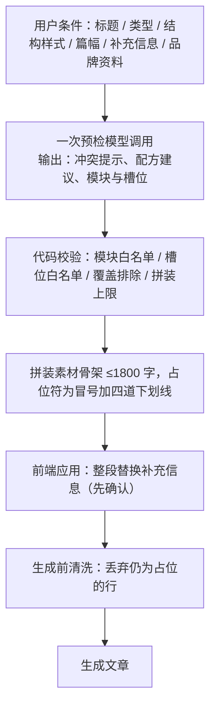

# 选题预检 v1：让用户在生成前确认"条件与素材够不够"

> 项目卡片 · 2026.08（v1.0–v1.25）· 角色：方案设计 + 交互 + 实现 · 状态：**已下线**——方案被"共享准备 + 正文后一次有界补查"取代

这篇文档记录一个**被我自己推翻的方案**。它最真实的部分不是设计得多精巧，而是我在什么时候意识到：为一个没被验证过的价值建系统，是最贵的浪费。

---

## 1. 为什么做预检

问题来自真实使用：用户填好标题、选好结构、点了生成，等一分多钟拿到一篇看起来不错的稿子，然后发现——

- 品牌资料没维护，正文里只能用通用描述代替；
- 没有可核验的案例/数字，文章只能写泛泛的建议；
- 标题是一个"对比型"问题，但他选的是"问题-答案型"结构，成稿答非所问。

返工成本很高：一次生成要等一分多钟，改条件后再生成一次，用户往往就流失了。

所以预检的定位是：**在付出生成成本之前，做一次短诊断，告诉用户"条件与素材够不够、建议怎么改"**。它不是"帮用户写 brief"，而是"降低一次生成就废掉的概率"。

---

## 2. 目标与非目标

**目标**：

- 预检 = **短诊断 + 一套推荐**（配方补丁 + 0–1 条补充信息骨架）；给出"加上它会明显更可信"的素材建议；
- 骨架随"内容类型 × 结构样式 × 篇幅"变化，专业、易懂、易填；
- 应用后对成稿真的有用；**禁止模型编造具体数字或客户名**；
- 生成前清洗未填占位，避免 `____` 泄漏进正文。

**非目标**：

- 不做完整 Brief 产品、不做多维互斥选择、不强制填完才能生成；
- 不替代用户真实素材；不做全文事实自检（CoVe 类）、不做 function-calling strict 硬校验、不做埋点大盘；
- 不做"发现问题"式的焦虑输出。

---

## 3. v1 的核心设计（每条：背景 → 取舍 → 结论 → 代价）

### 3.1 只给"一套推荐"，不做"多维选择器"

- **背景**：交互上最自然的做法是把所有建议摊开，让用户勾选；但选择越多，决策成本越高。
- **取舍**：选择自由 vs 决策成本。
- **结论**：预检只给**一套**推荐（配方补丁 + 至多一条补充信息骨架），用户只能"采纳 / 撤销 / 忽略"；没有"全部采纳"。
- **代价**：用户无法部分组合建议；对"我全都要"的用户显得克制。后来我保留了这个判断——**AI 建议和用户判断之间必须留一次点击**。

### 3.2 素材骨架由代码拼装，而不是让模型自拟

- **背景**：如果让模型直接写"你想补充什么"，它很容易写出"请提供贵公司的核心优势"这种废话，甚至编造一个字段标签。
- **取舍**：灵活（模型自由写）vs 可控（代码拼装）。
- **结论**：模型只输出模块 id 与槽位（如"客户案例：背景 / 做法 / 结果"），**模板正文由代码拼装**；拼装硬上限 1800 字（相对表单上限 2000 留缓冲；不信任 Prompt 计字）；异常超限时前端弹窗拒绝写入，**禁止静默截断**。
- **代价**：模板形状受模块库限制；LLM 只能在"槽位白名单"内表达，遇到全新题型时覆盖率不够。

### 3.3 用"覆盖排除"替代"字数够了就不给建议"

- **背景**：早期规则是"用户已经写了很多（删空后 ≥60 字）就全局跳过建议"，结果出现两种坏情况：写了一堆无关内容也跳过；写了相关的但没覆盖关键模块也不给建议。
- **取舍**：简单启发式 vs 结构化判断。
- **结论**：改成**按模块判断覆盖**——如果补充信息里已经有某模块的标题且块内有非空内容，就排除该模块，不重复建议；未覆盖的模块才出建议。
- **代价**：依赖用户按【模块】格式写；用户自由书写时覆盖判断会失效（后来这一条也是 v1 被推翻的伏笔之一）。

### 3.4 条件变更用"提示过期"，不硬清空结果

- **背景**：用户采纳建议后往往还要改标题/篇幅；如果一改就清空预检面板，付费得到的建议就丢了。
- **取舍**：结果永远最新（硬清空）vs 结果可能过期但可见（提示）。
- **结论**：预检成功时保存条件快照；条件变化后**保留面板**、追加"条件已变更，建议仅供参考"与"恢复初始条件"；不整盘禁用采纳；改回与快照一致时提示自动消失。
- **代价**：快照、撤销、基线三套状态彼此牵制，交互复杂度明显上升——这也是"小而美"功能最容易失控的地方。

### 3.5 工程哲学：先验只进 Prompt，运行时禁止兜底

两条当时定下的原则，我认为到今天仍然成立：

1. **选型先验只写进 Prompt，代码运行时不做兜底**。如果模型返回合法的空数组（"加上也不会明显更可信"），就直接无建议，不按样式静默生成一套默认建议。否则用户看到的建议是代码补的，模型其实没判断过。
2. **格式契约 + 有限恢复**。用 JSON 输出契约、低温、失败日志 + 至多 1 次重试；半截 JSON 不入库。当时也评估过 function-calling strict：官方标注 Beta、要求特定路由与严格 schema、第三方复测有过 malformed arguments，**默认不上**——结论是"能力存在、但不稳；应用侧校验兜底更划算"。

---

## 4. v1 的数据流



素材旁注的主路径：只有该字段存在建议时才显示旁注；"已采纳"= 当前值等于建议值（点采纳或手改到位同态）；无建议的字段**零旁注**；永远不展示"发现问题"。

---

## 5. 它后来为什么被推翻

2026.10 之后，我把文章链路重新做了一版 PRD（[02](./02-article-agent-prd.md)），预检 v1 的这套"模块 + 骨架 + 覆盖排除"被整体替换。原因不是它"做错了"，而是它解决的不是最痛的问题，而且维护成本在持续上升。

### 5.1 直接原因：两个入口不一致

- 预检自己准备资料（读手选资料、给条件建议），生成自己又准备一遍；
- 用户**直接点生成**就绕过了预检的条件检查；
- 结果是"预检说的"和"生成用的"不是同一份资料，口径不一致。

新方案把"资料准备 + 条件检查"合并成**一次共享准备**：预检和生成复用同一份准备快照，直接生成也会执行同样的准备（只是不显示建议）。这是推翻 v1 的第一推动力。

### 5.2 骨架的价值没有被验证

v1 假设："给用户一个可填的骨架 → 用户填 → 文章更可信"。但实际使用中：

- 用户经常**不填**（不知道填什么、不想暴露信息、或者觉得麻烦）；
- 填了也很难验证"更可信"——素材进入正文的效果要逐篇审阅才知道；
- 反过来，为了这套骨架，我维护了模块库、槽位白名单、覆盖排除、占位清洗、快照与撤销状态……一整套系统。

**为一个没有验证过价值的假设维护系统**，是我在这一版里最大的教训。

### 5.3 生成后补查比生成前补资料更划算

- 生成前补资料，用户往往还没看到草稿，不知道缺什么，只能凭想象填；
- 生成后有了正文，问题会具体暴露（"这句话没有依据""这个主体不对"），此时做**一次有界补查**（只在本账号知识库内、最多一次、预算有限）更精准，也更省。

所以新链路是：共享准备 → 规划 → 生成 → 一次编辑式质量复查 → **条件式**补查 → 有界修复 → 保存。

### 5.4 复杂度本身成了负债

v1 后期，一个"预检"功能已经牵扯：模块库、槽位、骨架拼装、覆盖排除、采纳/撤销/基线三套状态、占位清洗、条件快照、异常弹窗。每加一个规则，验收矩阵就长一截。而新方案把预检结果收敛成：

```text
summary + suggestions（一个字段最多一条）+ materialHints（必要时提醒私有资料）
```

模型只调用一次，只做格式恢复、不再检索。旧的 `llmModuleIds`、槽位、fillHints、任务覆盖等字段全部删除，不保留双轨兼容。

### 5.5 真实的失败也起了作用

- 思考（reasoning）开启时输出预算被推理占满，出现过 content 为空；
- 占位符清理规则一旦不严，`____` 漏进正文；
- 条件快照与"已采纳"状态的边界情况多，用户会困惑"我到底采纳没采纳"；
- 这些都不是"设计不好"，而是**一个复杂交互在缺少足够用户量打磨时必然积累的债务**。

### 5.6 推翻的代价

- 预检从"能产出可应用素材"变成"只给条件建议"，**用户感知价值下降**；
- 材料不足的问题从"生成前暴露"变成"生成后可能暴露"，返工成本回来了（由质量复查与提示兜底）；
- 已写的骨架相关代码、测试、交互基本作废。

我认为这个代价是值得的：**少一个看起来聪明但没被验证的功能，换来一条口径一致、可验收的链路。**

---

## 6. 复盘：v1 留下了什么

被推翻的方案里，仍然有值得留下的判断：

1. **不擅自改用户已选的标题/结构/类型**——建议只在用户点击后生效；
2. **无变化的建议不展示**，不伪称已采纳；
3. **没有"全部采纳"**，保留用户的一次判断；
4. **格式契约 + 有限恢复**（JSON、低温、最多一次格式恢复、半截不入库）；
5. **占位符清洗**的工程约定（中英文冒号都认，未填行整行丢弃，全空则视为无素材）；
6. **快照/基线思维**：结果要能说清"基于哪一版条件"，过期要可识别。

如果重来一次，我会先做一个小验证：**给 10 个用户看两版预检（有骨架 / 只有建议），看他们是否真的会填、填完的文章是否更好**。验证不过就不建系统——这比事后推翻便宜得多。

---

## 附：相关链接

- 后继方案：[内容生产 Agent（两条流水线、预算与门禁）](./02-article-agent-prd.md)
- 评测方法：[怎么定义好文章、怎么证明](./06-eval-and-boundaries.md)
- 作品集单页：<https://zhaolijian.github.io/cases/geo.html>
